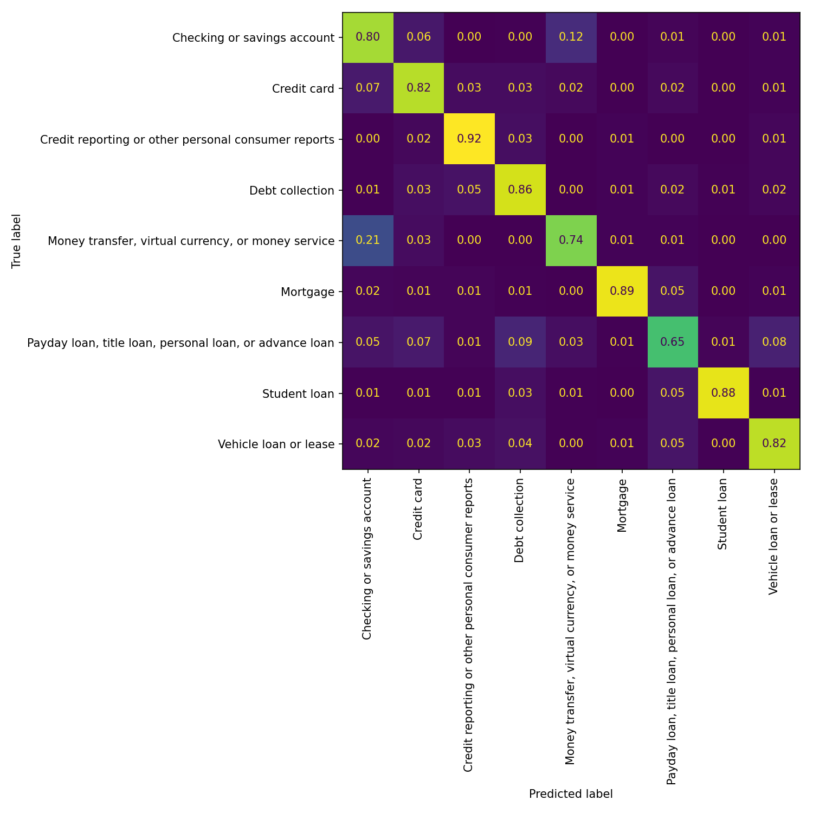

# Consumer Complaint Classifier (CFPB)

Classifies consumer financial complaints into product categories (debt collection, credit card, mortgage, etc.) so they can be routed to the right team automatically.

## Why this matters for a bank
Banks receive thousands of complaints, and each one has to reach the right team. Correct routing reduces response time and the risk of missed regulatory deadlines. Because some products are much rarer than others, I evaluate with per-class F1 and macro-F1, not just accuracy.

## Data
CFPB Consumer Complaint Database, Narratives Archive (export covering January-February 2026). Only complaints with a free-text narrative are used.

- Complaints used: 33,561 (train 23,492 / validation 5,034 / test 5,035, stratified split)
- Classes: 9 products (classes with fewer than 500 complaints are dropped)
- Class imbalance: Debt collection is about 35% of the training data, Student loan about 3%

The raw data is not included in this repo (see "How to run").

## Approach
1. Explored class balance and text length (`notebooks/01_data_exploration.ipynb`).
2. Baseline: TF-IDF (unigrams and bigrams) + Logistic Regression with balanced class weights.
3. Evaluated on a held-out test set with per-class precision, recall and F1, plus a confusion matrix.
4. Manual error analysis on a sample of 100 misclassified complaints.

## Results
| Model | Accuracy | Macro-F1 (test) |
|---|---|---|
| TF-IDF + Logistic Regression | 0.827 | 0.793 |
| DistilBERT (fine-tuned) | coming soon | coming soon |

Strongest classes: Debt collection, Mortgage and Student loan (F1 about 0.90).
Weakest class: Payday/title/personal loan (F1 0.572, precision 0.513).



## Error analysis
I manually reviewed a sample of 100 misclassified test complaints. Errors are spread across classes rather than concentrated in one. Complaints about everyday banking products (credit cards vs. checking/savings accounts) are often confused with each other, and the Credit reporting class has high recall (0.92) but low precision (0.60). Many complaints labeled Debt collection are in fact disputes about credit report entries, citing the FCRA and the credit bureaus, so the model's prediction is often defensible. Because labels are the product the consumer chose on a form, some errors reflect label ambiguity rather than model failure.

## Limitations and responsible use
- Labels come from the consumer's own product selection and can be noisy.
- Data covers a two-month period, so results may not generalize to other periods or to product names used in other years.
- Complaint text is redacted by the CFPB (XXXX); no personal data was added.
- In a real setting the model should suggest routing and send low-confidence cases to human review, not fully automate decisions.

## How to run
1. Download an export from the CFPB Consumer Complaint Database Narratives Archive and put the `.zip` (as downloaded, no need to unzip or rename) in `data/`.
2. Install and run:

```bash
pip install -r requirements.txt
python src/prepare_data.py
python src/train_baseline.py
python src/error_analysis.py
```

## Project structure
```
data/          raw export goes here (not tracked by git)
notebooks/     data exploration
src/           data prep, training, error analysis
results/       metrics, confusion matrix, error samples
```

## Next steps
- Fine-tune DistilBERT and compare against the baseline.
- Use prediction confidence to send uncertain cases to human review.
